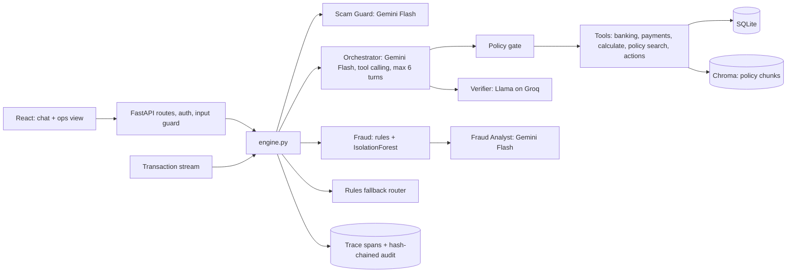

# Design: Daily Banking Assistant

Design v2, 24 Oct, 14:00, after the judges reviewed v1 (kickoff plan, 11:00). Requirements with IDs are in `docs/SRS.md`, the engine interface in `docs/ENGINE.md`, the HTTP contract in `docs/API.md`, and the reasons behind each choice in `docs/DECISIONS.md` (v2 changes are D-11 to D-22). If the plan changes, we update this file and log a decision.

## 1. Problem and users

Customers check balances, track spending, pay bills, follow EMIs and react to suspicious transactions across several apps and channels. Service teams answer the same requests all day. We're building one conversational assistant that gives a customer accurate, personal, explainable answers about their own money, carries out a few safe actions under bank controls, stops scams before the money leaves, and hands risky cases to a human, with every step traced.

Users: customer (retail banking), bank operations officer (reviews alerts, cases and traces).

Our rule in v2: **the LLM drives the conversation and picks the tools; code guards identity, permissions, maths and actions.**

## 2. What we're delivering

Demo scenarios:

1. Balance and recent transactions.
2. "How much did I spend this month?" by category, with a trend.
3. "What's due this week, and how much will I have left?" The model calls several tools in parallel and does the subtraction with `calculate`.
4. "I paid Ravi Rs 2,500 yesterday, the money left my account but he didn't get it." Status and UTR, the RBI deadline, a complaint ticket raised automatically, escalation if the deadline has passed.
5. "I lost my debit card" → confirmation + OTP → card blocked → replacement requested.
6. A Rs 48,999 card payment at 02:14 in Dubai arrives on the transaction stream → fraud score with reasons → alert → the customer is offered a card block.
7. "The bank officer on the phone says send Rs 30,000 to this UPI ID or my account gets frozen." Scam Guard flags it, the pre-payment check holds the payment, a human gets the case.
8. "What's the fee for a duplicate debit card?" answered from policy with a citation; an unknown topic gives `not_found`.
9. "Show me customer C1002's balance" → `refused`.
10. Operations view: alerts queue, trace viewer for any request, live metrics.

## 3. Architecture

One request end to end: "The bank officer on the phone says send Rs 30,000 to fix-kyc@okicici or my account gets frozen."

1. The route reads customer C1001 from the token and the input guard cleans the text. The message can never change who the customer is.
2. Scam Guard and the Orchestrator start in parallel. Scam Guard returns `high` (bank impersonation, urgency, unknown payee), and code sets the session's scam flag.
3. Orchestrator turn 1 calls `start_transfer(payee="fix-kyc@okicici", amount=30000)`. The gate checks the arguments; the tool runs the pre-payment check: first-time payee plus scam flag means **hold**. No pending action is created; a case goes to a human.
4. Turn 2: the model writes the reply from the tool result: payment held, the bank never asks for transfers over the phone, don't share an OTP.
5. Code checks that every amount in the reply appears in a tool result; the Verifier checks the claims. Both pass.
6. Response: `answer_type: escalated`, a `scam_suspected` warning, `trace_url`. Every step above is a span in the trace.

## 4. The four agents

| Agent | Model | Runs | Returns | What code still decides |
| --- | --- | --- | --- | --- |
| Orchestrator | Gemini Flash, native function calling | every message | tool calls, then the reply | which tools exist, the gate on each call, 6 turns at most |
| Scam Guard | Gemini Flash, JSON schema | every message, in parallel with the Orchestrator | `{risk: none/low/high, patterns, reason}` | the session flag, and what the pre-payment check does with it |
| Fraud Analyst | Gemini Flash, JSON schema | a transaction scores medium or high, or a customer disputes one | `{band, explanation}` | final band = the higher of the rules band and the analyst band |
| Verifier | Llama 3.3 70B on Groq | before any reply with amounts or citations | `{ok, problems}` | amounts are checked in code first; on failure one retry, then a safe templated reply |

How the Orchestrator loop works: we send the system prompt and the tool declarations from the registry. Each model turn may return several function calls; we run them in parallel, each through the gate, and send the results back. The loop stops when the model answers in text, or after 6 turns with a `clarification_needed` reply. We run the loop ourselves instead of the SDK's automatic function calling, so every call is gated and traced.

`answer_type` is set by code from what happened (a pending action was created, a case was escalated, the gate refused, `calculate` ran, a policy was cited), not chosen by the model. New in v2: `action_pending`.

**Fallback:** if Gemini fails after one retry, or `USE_LLM=0`, a rules router takes over: keywords pick an intent, a fixed tool list runs, a template writes the reply. The trace records `mode: fallback`. If Groq is down, the code amount check still runs and the trace marks the Verifier as skipped.

## 5. Guardrails in code

- **Identity:** the customer ID comes only from the token. Tools never take it as an argument; the gate strips it if the model sends one.
- **Policy gate on every tool call:** unknown tools, unknown arguments, wrong types and negative amounts are refused, and every allow or deny is a span.
- **Maths:** the model must call `calculate` for any sum. The amount check rejects a reply with a number that no tool produced.
- **Actions:** action tools only create a pending action. It runs after the customer confirms with a 6-digit OTP (5 minutes, 3 attempts).
- **Untrusted content:** tool results, transaction descriptions and policy text reach the model as function results or delimited data, never as instructions. Even a successful injection can only call tools this customer is already allowed, and actions still need the OTP.

## 6. Fraud and scam prevention

**Detection (after a transaction):** `ingest_transaction` scores every new transaction. Score = weighted rules (amount vs the 90-day median, first-time merchant, 00:00 to 05:00, a city away from home, rapid repeats) + an IsolationForest anomaly signal, each with a plain-language reason. Weights and bands are in CLAUDE.md. Medium or high goes to the Fraud Analyst, which can raise the band and adds an explanation, but can never lower it. Medium and high create an alert; high also offers a card block.

**Prevention (before a payment):** every transfer passes a pre-payment check first. Signals: first-time payee, amount over 3x the usual transfer, scam flag in the session. Outcomes: **hold** (no payment, case to a human), **cooling-off** (runs after 30 minutes unless cancelled), **step-up** (a warning the customer must acknowledge, then OTP), or normal OTP. Exact rules are in CLAUDE.md.

## 7. Debited but not received

`check_transaction_status` returns the state (success, pending, failed-but-debited, reversed), the UTR and the RBI deadline. RBI turnaround times, T = transaction date: UPI and IMPS reverse by T+1, ATM by T+5, then Rs 100 compensation per day of delay. Inside the deadline we raise a complaint ticket automatically and tell the customer the date. Past it we escalate to a human with the compensation worked out in code.

## 8. Traceability

Every request gets a trace ID and a list of spans: input guard, each LLM call (agent, model, tokens in and out, ms), each gate decision, each tool call (arguments, result, ms), the Verifier result and any action. Spans are written to an audit table where each row's hash covers the previous row's hash, so editing or deleting a row breaks the chain (`verify_chain`). The ops view shows any trace by ID, and `metrics()` reports latency, token use, fallback rate, Verifier pass rate, alerts by band and chain status.

## 9. Stack, data and API

**Stack:** Python 3.12, FastAPI, SQLite, Chroma, `bge-small-en-v1.5`, rank-bm25, scikit-learn (IsolationForest), Gemini Flash through google-genai, Llama 3.3 70B on Groq, pytest. Frontend: React.

**Data (synthetic, `app/seed.py`, dated relative to today):** 3 customers and an officer, about 90 days of transactions with planted cases (the Dubai card payment, two failed-but-debited UPI payments inside and past the deadline, a failed ATM withdrawal), cards, loans, bills, payees, products, and 5 policy documents with version and effective date.

**Tables:** `customers`, `accounts`, `transactions`, `cards`, `loans`, `bills`, `payees`, `products`, `complaints`, `alerts`, `cases`, `pending_actions`, `traces`, `audit`, `counters`. Still to add: `sessions` (per-session flags such as the scam flag), so the API holds no state in memory.

**API:** see `docs/API.md`. Routes call the six engine functions in `docs/ENGINE.md` and hold no banking logic.

## 10. Cloud and scale

What we build today: a Dockerfile and a stateless API (sessions, OTPs and pending actions live in the database, not in memory), so it runs unchanged on Cloud Run.

The production version of the same design:
- Postgres + pgvector instead of SQLite + Chroma: one store, many writers, the same tables.
- Redis for session flags, OTPs and rate limits.
- Pub/Sub topic for the card and UPI transaction stream; a push subscription calls `ingest_transaction`.
- Gemini → Groq failover for the Orchestrator, with the rules router as the last resort.
- Secret Manager for keys, Cloud Run scaling on request count.

We don't build any of the production list today, and we say so in the demo.

## 11. Team, plan and risks

| Time | Ayush (core engine) | Teammate 2 (frontend, routes) | Teammate 3 (fraud ML, policies, eval) |
| --- | --- | --- | --- |
| 14:00 to 14:45 | `llm.py`, Orchestrator loop, fallback router, `handle_chat` | Routes over an engine stub, login, `guard.py` | `fraud/ml.py`, 5 policy documents |
| 14:45 to 15:30 | Payments + TAT, actions + OTP, fraud score + Analyst, Scam Guard, pre-payment check | React chat, OTP dialog, warnings, trace link | 30 questions in `eval/questions.jsonl`, `run_eval.py` |
| 15:30 to 16:00 | Verifier, `metrics()`, policy search | Ops view: alerts, trace viewer, metrics | Run the eval, numbers into README |
| 16:00 to 16:30 | Freeze, Dockerfile, README, rehearsal | Demo flow | Demo backup recording |

**Risks and fallbacks:**
- LLM rate limits or outage: the rules router, then a recorded demo video.
- The agent picks a wrong or wasteful path: the gate, the 6-turn cap and the trace make it visible. If the eval shows it, we tighten the tool descriptions.
- Latency from four agents: Scam Guard runs in parallel, the Analyst only on suspicious transactions, the Verifier only on replies with amounts or citations.
- Running out of time. Cut in this order: Verifier claim check (keep the code amount check), cooling-off, FR-18, FR-14.
