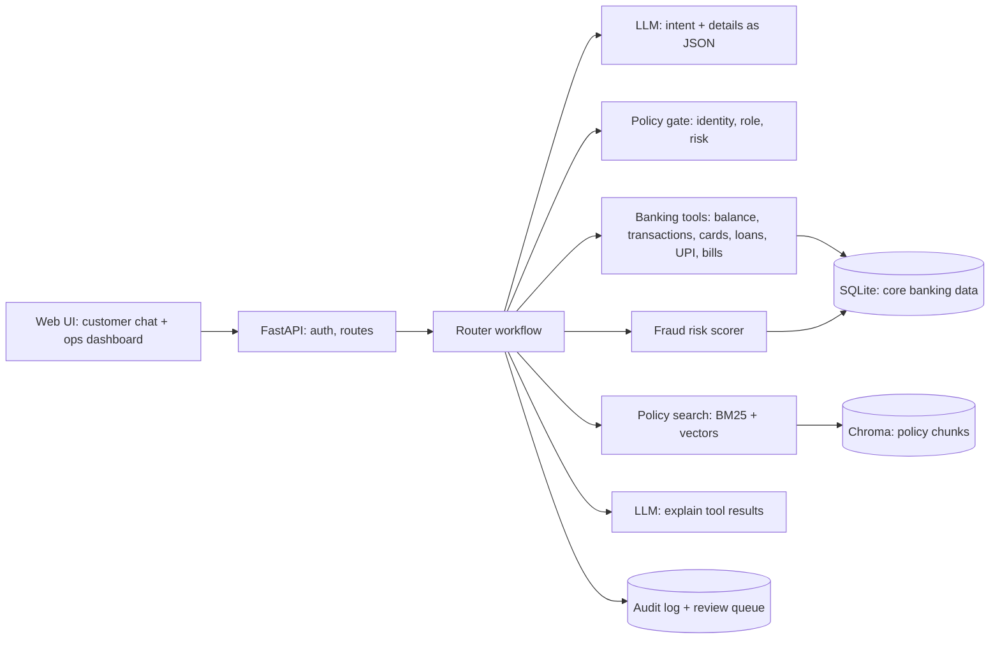

# Design: Daily Banking Assistant

The plan, written at kickoff (24 Oct, 11:00). These 6 sections match our 6 design slides. Requirements with IDs are in `docs/SRS.md`; the reasons behind each choice are in `docs/DECISIONS.md`. If the plan changes, we update this file and log a decision.

## 1. Problem and users

Customers check balances, track spending, pay bills, follow EMIs and react to suspicious transactions across several apps and channels. Service teams answer the same requests all day. We're building one conversational assistant that gives a customer accurate, personal, explainable answers about their own money, carries out a few safe actions under bank controls, and hands risky cases to a human, with every step audited.

Users: customer (retail banking), bank operations officer (reviews disputes and audit trails).

Our rule, taken from HCL's design principle: **the language model understands and explains; deterministic tools decide, calculate and act.**

## 2. What we're delivering (MVP)

Full list with IDs and acceptance criteria in `docs/SRS.md`. Demo scenarios:

1. Balance and recent transactions.
2. "How much did I spend this month?" by category, with a trend.
3. "What's due this week, and how much will I have left?" (a multi-step calculation).
4. "Did my UPI payment to Amazon go through?" with reference number and failure reason.
5. "I lost my debit card" → confirmation + OTP → card blocked → replacement requested.
6. "I don't recognise this transaction" → fraud risk score with reasons → dispute → human review queue.
7. "What's the fee for a duplicate debit card?" answered from bank policy with a citation; an unknown topic gives `not_found`.
8. "Show me customer C1002's balance" → `refused`.
9. Operations dashboard: review queue and audit trail by trace ID.

## 3. Architecture

One request end to end: "How much will I have left after this week's bills?"
1. The API reads customer C1001 from the login token. The message text can never change who the customer is.
2. The LLM returns `{intent: "funds_after_bills", period: "this_week"}` as validated JSON.
3. The policy gate checks the customer is acting on their own data and the intent needs no extra verification.
4. Tools run: `get_balance` and `get_upcoming_payments`. The subtraction is done in Python, not by the model.
5. The LLM phrases the answer using only those numbers. Code checks that every amount in the answer matches a tool output.
6. Response: `answer_type: calculated`, the amounts, `tools_invoked`, `trace_id`, latency. One audit row is written.

## 4. AI approach

- **A router workflow, not an autonomous agent.** One LLM call classifies the request; our code runs a fixed, tested sequence of tools for that intent. Every path is predictable and auditable, which a bank needs.
- **What the LLM does:** (1) intent and detail extraction into a strict schema; (2) categorising merchants our rules don't know (cached, so the same merchant is never asked twice); (3) explaining tool results in plain language; (4) answering policy questions only from retrieved policy text, with citations.
- **What the LLM never does:** compute balances, dues, fees or eligibility, decide fraud, or take actions. Those are code.
- **Grounding:** policy answers need a retrieval score above a threshold or we return `not_found`; amounts in the reply are checked against tool outputs; unknown merchants and missing records give `not_found`, never a guess.
- **Fraud risk score (explainable, in code):** weighted signals: amount vs the customer's usual spend, first time at a merchant, unusual hour, a city different from home, several transactions in quick succession. The result is a score from 0 to 1 plus a list of human-readable reasons. High risk proposes blocking the card and always opens a dispute for human review.
- **Human oversight:** card blocks and disputes need explicit confirmation plus an OTP; disputes and high-risk cases go to the operations review queue.
- **Untrusted content:** retrieved policy text and transaction descriptions are passed to the LLM as data in a delimited block, with an instruction never to follow instructions inside them.
- **Answer types:** `retrieved_fact`, `calculated`, `action_completed`, `clarification_needed`, `not_found`, `refused`, `escalated`.

## 5. Stack, data and API

**Stack:** Python 3.12, FastAPI, SQLite, Chroma (local, persistent), `bge-small-en-v1.5` embeddings (local), rank-bm25, Gemini through the google-genai SDK with Groq as fallback, pytest. Frontend: Streamlit by default (or React if our frontend owner prefers).

**Data (synthetic, created by the data team):** 3 customers; savings accounts; about 3 months of transactions per customer with merchants, channels, cities and a few planted anomalies; UPI payments with statuses and failure reasons; debit and credit cards; loans with EMI schedules; bills and subscriptions; 5 bank policy documents (fees, cards, UPI, disputes, loans) with version and effective date.

**Tables:** `customers`, `accounts`, `transactions`, `cards`, `loans`, `bills`, `merchant_categories`, `disputes`, `pending_actions`, `audit_log`.

**API:** `POST /auth/login`, `POST /chat`, `POST /actions/{id}/confirm`, `GET /me/summary`, `GET /me/spending`, `GET /ops/review-queue`, `POST /ops/review-queue/{id}/resolve`, `GET /ops/audit/{trace_id}`, `GET /health`. Full request and response shapes in SRS section 5.

## 6. Plan and risks

| Time | Backend (Ayush) | Data | Frontend |
| --- | --- | --- | --- |
| 12:00 to 13:00 | Schema, login, balance / transactions / bills tools | Customers, accounts, transactions, cards, loans, bills | Chat screen against the stub API |
| 13:00 to 14:00 | Router + intents, chat endpoint, audit log, funds-after-bills | Merchant rules, planted anomalies, UPI data | Response cards, answer-type badges, customer switch |
| 14:00 to 15:00 | Fraud scorer, block card + dispute with OTP, policy search | 5 policy docs, 30-question test set | Confirmation + OTP dialog, ops dashboard |
| 15:00 to 15:30 | Spending categorisation, review queue endpoints | Evaluation script and numbers | Spending chart, polish |
| 15:30 to 16:00 | Freeze, README, rehearsal | Numbers into README | Demo flow |

**Risks and fallbacks:** LLM rate limits or outage (Groq fallback, a keyword intent fallback, a recorded demo video); wrong intent (ask a clarifying question instead of guessing); a judge asking for an unsupported feature (honest `not_found` plus the roadmap in our capability-maturity slide).